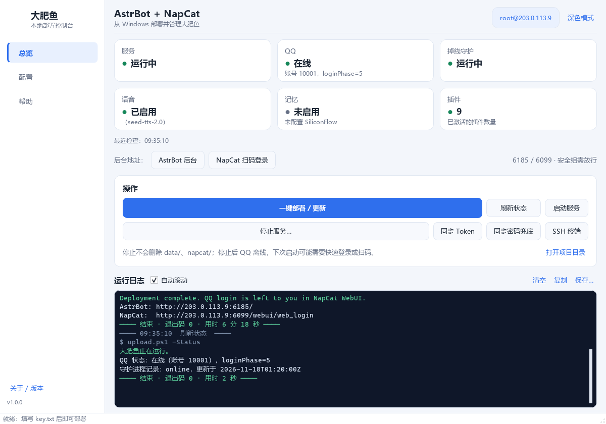

# 从零部署大肥鱼：Windows → Ubuntu

## 1. 填写密钥

首次使用，如果目录中有 `key.example.txt`，复制为 `key.txt`；没有就按本表字段新建 `key.txt`。用记事本以 UTF-8 保存。配置字段每行 `名称=值`，按字段名读取，可调整顺序，不要加引号；密码里有 `=`、`#` 不需要转义。已收到填写好的 `key.txt` 时直接编辑。成功后自动写在末尾的两行 URL 仅供查看，读取配置时会忽略。

| 字段 | 怎么填 |
|---|---|
| `SSH_HOST` | 服务器公网 IPv4 或域名 |
| `SSH_USER` | 建议使用 `root`；其他用户需要免密 sudo 权限 |
| `SSH_PASSWORD` | SSH 登录密码 |
| `DEEPSEEK_API_KEY` | DeepSeek 开放平台 API Key，需有可用额度 |
| `DEEPSEEK_MODEL` | 默认 `deepseek-flash`；按平台实际提供的模型填写 |
| `SILICONFLOW_API_KEY` | 可选，用于 `BAAI/bge-m3` 云端记忆；空着跳过记忆 |
| `DOUBAO_API_KEY` | 可选，豆包语音控制台「API Key 管理」里创建的 API Key；填了就启用「豆包·语音合成模型 Seed-TTS 2.0」 |
| `DOUBAO_APP_ID` | 可选，和 API Key 同一个账号的 App ID；填了会随请求一起带上，留空也可以 |
| `DOUBAO_SPEAKER` | 可选，Seed-TTS 2.0 的音色 ID，留空用默认 vivi 2.0（`zh_female_vv_uranus_bigtts`）；2.0 要用 `*_uranus_bigtts` 音色 |
| `DOUBAO_ACCESS_TOKEN` | 可选，旧版 Seed Audio 1.0（唱歌/旧控制台）的 Access Token；只有 `DOUBAO_API_KEY` 留空时才用，和 App ID 同时填才生效 |
| `OWNER_QQ` | 可选，你的大号 QQ；空着时不设置管理员，也不主动私聊 |
| `ONEBOT_TOKEN` | 留空，自动生成；这是两个容器之间的独立连接凭证 |
| `ASTRBOT_USERNAME` | 想设置的 AstrBot 后台账号 |
| `ASTRBOT_PASSWORD` | 至少 8 位，包含大写、小写字母及数字 |
| `NAPCAT_TOKEN` | 留空，启动并验证后台后自动回填实际 Token |
| `QQ_WATCHDOG_WEBHOOK` | 可选，QQ 掉线/恢复通知的 webhook 地址；空着不发通知 |

豆包语音控制台在「API Key 管理」创建 API Key，填到 `DOUBAO_API_KEY` 就启用「豆包·语音合成模型 Seed-TTS 2.0」：部署时用 `X-Api-Key` 鉴权，音色默认 vivi 2.0（`zh_female_vv_uranus_bigtts`）。想换音色就填 `DOUBAO_SPEAKER`（控制台「音色库」里的 ID，2.0 必须用 `*_uranus_bigtts` 结尾的音色，比如 `zh_female_xiaohe_uranus_bigtts`、`zh_male_m191_uranus_bigtts`）。旧版控制台仍可继续用同一语音应用的 App ID 和 Access Token 走旧版 Seed Audio 1.0（两项都填才生效，且 `DOUBAO_API_KEY` 优先）。旧版界面：[打开旧版控制台](https://console.volcengine.com/speech/service/10035?AppID=2320335936)。链接中的 `AppID` 为示例，请切换到自己的应用。如果接口返回 `requested resource not granted`，说明账号还没开通 Seed-TTS 2.0（或旧版 Seed Audio）服务，先在豆包语音控制台开通再部署；音色和模型不匹配会提示 `resource ID is mismatched with speaker`。语音测试没通过时脚本会保留凭证、先关掉语音并继续基础部署；改好后重跑一次部署会自动重试语音（失败状态不会让部署直接跳过），也可以用 `sudo bash deploy.sh --configure` 强制重测。

**豆包语音：填了 `DOUBAO_API_KEY` 就用 Seed-TTS 2.0 说话；只有旧版 App ID + Access Token 时才回退到 Seed Audio 1.0。两种都没填就跳过语音和唱歌，不安装相关插件，不调用语音接口，也不会偷偷改用其他语音服务。** 注意：Seed-TTS 2.0 只能说话不能唱歌；唱歌走旧版 Seed Audio 1.0，账号要开通该服务（同一个豆包账号的 API Key 通常也能唱，部署时会自动尝试，唱不了会在对话里自己认怂）。机器人 QQ 号码和密码默认不需要填写，最后由用户自行扫码；如需密码自动兜底，可在项目目录创建 `QQ.txt`（格式见第 4 节），一键部署会自动同步到服务器。

在阿里云安全组入方向放行 TCP **6099（NapCat）**、**6185（AstrBot）**，并保留 SSH 默认端口 **22**。
## 2. Windows 一键部署

在 PowerShell 中打开 `dafeiyu_quick_deploy` 文件夹，然后运行：

```powershell
powershell -NoProfile -ExecutionPolicy Bypass -File .\upload.ps1
```

脚本会直接读取 `key.txt` 中的 `SSH_PASSWORD`，上传、连接服务器和同步 Token 都无需再次输入密码。SSH 固定使用默认端口 22；密码不会显示在终端或放进命令行。仅使用 Windows 自带的 tar、OpenSSH 和 .NET Framework，不需要本机安装 Python。

如果更习惯图形界面，可使用第 6 节的本地 Qt 控制台（可选；可直接使用打包好的 exe，也可从源码运行，命令行方式仍可独立使用）。

保留同目录下的 `ssh-askpass.cs`：脚本会在 Windows 系统临时目录编译密码读取助手，并在退出时自动清理助手、传输包等临时文件。项目目录中只保留发布用文件。

如果提示缺少 OpenSSH Client，用**管理员 PowerShell**安装 Windows 官方可选功能，再重跑：

```powershell
Add-WindowsCapability -Online -Name OpenSSH.Client~~~~0.0.1.0
```

成功后，文件位于服务器当前 SSH 用户的 `~/dafeiyu`。只上传 `deploy.sh`、`configure.py`、`compose.yaml`、`qq_watchdog.py`、`start.sh`、`stop.sh`、`pack/` 和填写好的 `key.txt`。`QQ.txt` 不会进入上传包；如果项目目录存在该文件，部署成功后脚本会单独把它同步到服务器的密码兜底文件（内容不在终端显示）。SSH 主机身份记录使用 Windows 用户目录下标准的 `.ssh/known_hosts`，不会随部署包分发。

上传完成后，脚本会立即通过 SSH 执行 Ubuntu 部署命令，并在当前 PowerShell 窗口显示进度。部署成功后，自动将 NapCat 和 OneBot Token 同步回本机 `key.txt`，并在文件末尾写入两个后台的实际 URL，地址取自 `SSH_HOST`。重复运行会更新这两行，不会累积重复地址。全程保持窗口开启，无需另开 Ubuntu 终端，也无需手动执行部署命令。

如果项目目录存在 `QQ.txt`，部署成功后还会自动把它写入服务器 `~/dafeiyu/secret/qq-login.txt`（目录 700、文件 600），供 QQ 掉线守护做密码兜底；没有该文件就跳过。QQ.txt 的格式见第 4 节，内容不会打印到终端；只想更新密码文件时可运行 `.\upload.ps1 -SyncPassword`，不必完整部署。`QQ.txt` 只允许 `QQ_ACCOUNT`、`QQ_PASSWORD`、`QQ_PASSWORD_MD5` 三个字段（账号纯数字、MD5 为 32 位十六进制），格式错误会在部署开始前报错；删除本机 `QQ.txt` 只会让下次部署跳过同步，不会删除服务器上已有的密码文件。

重复运行一键部署是安全的（幂等）。如果最后 `--check` 提示 `NapCat 后台认证失败：login rate limit`，那是 NapCat WebUI 每分钟 3 次登录的限制（连续重跑或同时开着 WebUI 时容易触发）：脚本会自动等待限流窗口，必要时降级使用守护进程最近状态判断 QQ 是否在线，不再让部署因此失败；仍失败时隔 1 分钟重跑即可。若最后只提示“Token 写回本机 key.txt 失败”，说明服务器已部署完成，关闭占用 key.txt 的程序后运行 `.\upload.ps1 -SyncKey` 即可。

部署完成后，日常启停可直接在本地运行 `upload.ps1 -Start` / `-Stop` / `-Status`（自动读取 key.txt 的 SSH 凭据，见第 5 节）。

脚本会在上传前检查服务器的 ED25519 主机密钥。首次连接自动保存；已保存的密钥一致时直接继续。重装系统后密钥发生变化，或之前只保存过其他类型的密钥时，脚本会显示旧、新 SHA256 指纹，要求输入 `YES` 确认。确认后自动备份为 `known_hosts.old`、刷新该服务器记录并继续部署；直接回车则退出，保留原记录。

主机密钥探测不发送 SSH 密码或客户端私钥；正式上传和连接会严格校验已保存的公钥。

可在阿里云服务器控制台的远程终端中执行以下命令核对新指纹，再回到本地确认：

```bash
ssh-keygen -lf /etc/ssh/ssh_host_ed25519_key.pub -E sha256
```

## 3. 登录后台并扫码

脚本依次：配置国内软件源 → 安装 Docker/Compose → 生成持久化配置和设备标识 → 下载并校验固定镜像 → 启动两个服务 → 回填 NapCat Token → 安装 QQ 掉线守护 → 导入人格、插件、记忆/可选语音 → 检查服务。

Ubuntu 软件包使用阿里云源，Docker 安装包使用南大镜像源。首次下载镜像、插件依赖和表情包需要数分钟到十几分钟，按实际网络而定。出现下载错误时按输出修正后重跑原命令，已有镜像层、插件、数据和 QQ 会话会复用。成功部署且密钥与配置包未变时，重复运行会跳过配置导入及收费模型测试。

服务器部署时会生成 `data/`、`napcat/` 和 `state/`，分别存放机器人数据、QQ 会话及部署状态。这些运行数据不包含在发布包中，每位用户部署时自行生成。

完成后，可直接使用本机 `key.txt` 末尾的 URL 打开后台：

- AstrBot：`http://你的服务器IP:6185/`，使用 `key.txt` 中的 AstrBot 账号密码。
- NapCat：`http://你的服务器IP:6099/webui/web_login`，使用自动回填到本机 `key.txt` 的 `NAPCAT_TOKEN`。

脚本不会把 Token 打印到录屏终端。**此时 QQ 尚未登录是正常状态**。用户进入 NapCat 后，用机器人小号的手机 QQ 扫码、按腾讯提示确认。二维码失效就在网页刷新。随后从自己的 QQ 发一句话测试回复。

部署报错时，按终端提示修正后重跑同一个命令。需要单独连接服务器或重新同步 Token 时，可分别给 `upload.ps1` 加上 `-Connect` 或 `-SyncKey`；正常部署会自动完成 Token 同步。

## 4. QQ 掉线自动恢复（守护进程）

部署脚本会安装 `dafeiyu-qq-watchdog.service`。它每 20 秒通过 NapCat 本机接口检查一次 QQ 登录状态，检测到被踢下线后按顺序尝试：

1. 使用 NapCat 本地保存的登录凭证做“快速登录”（与 NapCat WebUI 上的快速登录相同，不需要 QQ 密码）。
2. 如果服务器上配置了可选的 QQ 密码文件（默认关闭，见下文），尝试一次密码登录。
3. 快速登录和密码登录都不行时，重启 NapCat 的 QQ 登录进程，让它在启动时再自动快速登录一次。
4. 仍然失败就刷新登录二维码，在 `state/qq-watchdog.json` 记录“等待扫码”，等你本人扫码。

新部署且 QQ 尚未首次登录时，守护进程只等待你扫码，不会自动重启登录服务，避免二维码失效。

自动恢复有频率上限（快速登录每小时最多 4 次，重启每小时最多 2 次，两次重启至少间隔 15 分钟；密码登录每 24 小时最多 3 次），避免和另一台终端的登录互相踢下线。守护进程**不保存 QQ 密码**，除非你主动在服务器本地创建密码文件；它不做验证码、新设备验证或扫码自动化，遇到腾讯要求人工验证会停止自动尝试并等你处理。

查看状态：

```bash
sudo python3 ~/dafeiyu/qq_watchdog.py --status     # 当前 QQ / WebUI / 守护进程状态
sudo systemctl status dafeiyu-qq-watchdog          # 服务状态
sudo journalctl -u dafeiyu-qq-watchdog -n 50       # 最近日志
sudo cat ~/dafeiyu/state/qq-watchdog.json          # 状态文件
```

需要人工扫码时，直接打开 NapCat WebUI（`key.txt` 末尾的 NapCat 地址）扫码即可；守护进程冷却 15 分钟后会再尝试快速登录。

### 可选：QQ 密码自动兜底（默认关闭）

如果“登录已失效”后快速登录和重启都无效，可以额外启用密码兜底。**QQ 号码和密码只保存在服务器本地文件里**，不放进 `key.txt`、不进入上传包、不写日志；密码登录只是腾讯允许密码登录时才有效，若腾讯要求验证码/新设备验证/手机确认，会自动停止并等你处理。

最简单的开启方式：在项目目录新建 `QQ.txt`（这个文件已加入 `.gitignore`）：

```text
QQ_ACCOUNT=机器人QQ号
QQ_PASSWORD=机器人QQ密码
```

然后运行一次一键部署：

```powershell
powershell -NoProfile -ExecutionPolicy Bypass -File .\upload.ps1
```

部署成功后会自动把 `QQ.txt` 同步为服务器 `~/dafeiyu/secret/qq-login.txt`（目录 700、文件 600）；没有 `QQ.txt` 就跳过同步（服务器上已有密码文件不会被自动删除）。之后只修改了 `QQ.txt` 时，运行 `.\upload.ps1 -SyncPassword` 即可重新同步，不需要完整部署。

如果不想在本机保存密码，也可以直接在服务器上开启（交互输入，不回显、不进 shell 历史）：

```bash
# 推荐：交互输入
sudo python3 ~/dafeiyu/qq_watchdog.py --set-password
# 或手动创建（二选一）：
sudo mkdir -p ~/dafeiyu/secret && sudo chmod 700 ~/dafeiyu/secret
sudo nano ~/dafeiyu/secret/qq-login.txt     # 内容：QQ_ACCOUNT=机器人QQ / QQ_PASSWORD=密码
sudo chmod 600 ~/dafeiyu/secret/qq-login.txt
```

也支持只写 `QQ_PASSWORD_MD5=`（32 位小写 MD5）代替明文密码。密码文件权限必须是 600（组/其他不可读），否则守护进程拒绝使用；修改密码文件后无需重启，下一次尝试会重新读取。关闭密码兜底：`sudo python3 ~/dafeiyu/qq_watchdog.py --clear-password` 或删除该文件。

也可以把本机写好的账号密码文件直接传到服务器（内容格式同上）：

```bash
scp qq-login.txt root@你的服务器:~/dafeiyu/secret/qq-login.txt
ssh root@你的服务器 "chmod 700 ~/dafeiyu/secret && chmod 600 ~/dafeiyu/secret/qq-login.txt"
```

文件里的 `QQ_ACCOUNT` 必须与机器人 QQ 号一致，否则守护进程会拒绝使用。**不要把密码合并进 `key.txt`**：`key.txt` 每次部署都会整体上传并在服务器保留一份，密码会多出副本；只保存在服务器的 `secret/qq-login.txt` 即可，重新部署不会删除该文件。

安全提醒：密码明文落盘意味着服务器被入侵时 QQ 号可能被盗，请只用专用机器人小号并设置独立密码；不建议在群里传播或在录屏中展示该文件。密码错误会暂停 24 小时，反复自动密码登录可能触发腾讯风控，所以默认关闭、且有频率上限。

可选通知：在 `key.txt` 增加一行 `QQ_WATCHDOG_WEBHOOK=你的 webhook 地址`，掉线、自动恢复、等待扫码、密码登录失败/需要验证、WebUI 不可用、人工停机时会向该地址 POST 一段 JSON。webhook 地址可能带密钥，不要外传；修改后重新上传部署生效。

**注意**：日志里出现 `[KickedOffLine] 您的账号已在另一台终端登录`，说明有另一个设备或客户端登录了同一个 QQ。这种情况下任何自动登录都会把对方踢掉，从而可能来回互踢——守护进程只做有限次恢复，请尽量只让服务器上的 NapCat 登录机器人 QQ。若腾讯提示“登录已失效/需要重新登录”，优先由你用手机 QQ 扫码或确认；密码兜底也不保证通过腾讯的安全验证。

## 5. 日常启动和停止

`start.sh` / `stop.sh` 是服务器上的脚本，随 `upload.ps1` 上传到 `~/dafeiyu/`。**在本地 PowerShell（项目目录）直接运行下面的命令即可启停，脚本会自动读取 `key.txt` 中的 `SSH_HOST` / `SSH_USER` / `SSH_PASSWORD`，复用部署时保存的 SSH 主机密钥验证，不需要手输服务器地址或密码：**

```powershell
# 查看状态（容器、掉线守护、QQ 登录）
powershell -NoProfile -ExecutionPolicy Bypass -File .\upload.ps1 -Status

# 启动（容器 + QQ 掉线守护）
powershell -NoProfile -ExecutionPolicy Bypass -File .\upload.ps1 -Start

# 停止（先停掉线守护，再停 NapCat/AstrBot；数据与 QQ 登录状态保留）
powershell -NoProfile -ExecutionPolicy Bypass -File .\upload.ps1 -Stop
```

可选参数（一般用不到）：

```powershell
powershell -NoProfile -ExecutionPolicy Bypass -File .\upload.ps1 -Start -StartArgs '--no-wait'
powershell -NoProfile -ExecutionPolicy Bypass -File .\upload.ps1 -Stop -StopArgs '--dry-run'   # 只预览停止动作
powershell -NoProfile -ExecutionPolicy Bypass -File .\upload.ps1 -Stop -StopArgs '--down'      # 停止并移除容器
powershell -NoProfile -ExecutionPolicy Bypass -File .\upload.ps1 -Stop -StopArgs '--timeout','120'
```

这些命令只操作服务器上已有的服务，**不会上传文件或重新部署**；第一次部署、更新代码仍用不带参数的 `upload.ps1`。`-Stop` 后 QQ 会离线，下次 `-Start` 时守护进程会尝试快速登录/密码兜底，仍不行再到 NapCat 后台扫码。

如果需要进入服务器手动执行脚本，用 `powershell -NoProfile -ExecutionPolicy Bypass -File .\upload.ps1 -Connect` 打开 SSH 终端后，按下面「服务器上的命令」操作即可。

### 服务器上的命令（手动执行时参考）

```bash
sudo bash ~/dafeiyu/start.sh            # 启动 AstrBot、NapCat，并启动掉线守护
sudo bash ~/dafeiyu/start.sh --status   # 只看状态：容器、守护进程、QQ 登录
sudo bash ~/dafeiyu/start.sh --no-wait  # 启动但不等待后台端口

sudo bash ~/dafeiyu/stop.sh --dry-run   # 预览会做什么，不做任何改动
sudo bash ~/dafeiyu/stop.sh             # 先停守护，再优雅停 NapCat、AstrBot；数据与 QQ 登录保留
sudo bash ~/dafeiyu/stop.sh --down      # 停止并移除容器（data/、napcat/ 保留）
sudo bash ~/dafeiyu/stop.sh --timeout 120
```

选项说明：

| 脚本 | 选项 | 作用 |
|---|---|---|
| start.sh | 无 | 拉起已有容器并启动 QQ 掉线守护进程 |
| start.sh | `--status` | 只显示容器、守护进程、QQ 登录状态，不做改动；全部正常时退出码 0 |
| start.sh | `--no-wait` | 启动后不等待后台端口就绪 |
| stop.sh | 无 | 停守护进程 → 停 NapCat → 停 AstrBot，数据与 QQ 登录保留 |
| stop.sh | `--dry-run` | 只打印将执行的操作，不做任何改动 |
| stop.sh | `--down` / `-d` | 停止后移除容器（不动 `data/`、`napcat/`、`state/`） |
| stop.sh | `--timeout N` | 优雅退出的等待秒数，默认 60 |

说明：

- 两个脚本只启停现有容器，不联网拉镜像、不改配置；首次安装、更新代码仍用 `upload.ps1`。
- `start.sh` 会确保 `dafeiyu-qq-watchdog` 已启用并运行；`stop.sh` 会先停守护进程，避免它在停机过程中把容器又拉起来。停完守护不会自动启用，下次 `start.sh` 会重新启动它。
- 真正执行 `stop.sh` 后 QQ 会离线，下次启动需要通过快速登录/密码兜底或重新扫码恢复；只想确认脚本会做什么时先用 `--dry-run`。
- `--down` 只删除容器，不删除 `data/`、`napcat/`、`state/`，下次 `start.sh` 会重新创建容器。
- 手动 `stop.sh` 后，容器不会因服务器重启自动拉起；如果没手动停过，服务器重启后容器和守护进程都会自动启动。
- 只重启容器而不想停守护进程时，用 `cd ~/dafeiyu && sudo docker compose restart` 即可。
- 日常状态用本地 `upload.ps1 -Status` 查看即可，不需要登录服务器。

身份验证信息失效，不使用国家数字身份认证平台解封链接（在小号QQ中通过发消息打开）
https://accounts.qq.com/safe/message/unlock/verify?punish_id=10201&reason=12

## 6. 本地图形界面（可选）

`dafeiyu_gui/` 是 `upload.ps1` 的本地 Qt 桌面封装，适合不想反复输入 PowerShell 命令的场景。它**只在本机运行**，不会上传到服务器，也不改变任何部署逻辑；命令行部署、启动、停止方式继续完全可用。



### 直接运行 exe（推荐）

项目目录已生成 `大肥鱼控制台.exe`（Windows 10/11 x64 单文件程序），双击即可启动，不需要安装 Python、PyQt5 或打开命令行窗口。

- exe 是单文件程序，但仍需要通过项目里的 `upload.ps1`、`key.txt` 等文件操作服务器：请把它放在项目目录中（与本 README、`upload.ps1`、`key.txt` 同级）。如果放在项目根目录下的 `dist` 子目录，启动时会自动向上一级查找项目文件。
- 单文件 exe 首次启动会解压到系统临时目录，可能需要等待几秒。
- 如果启动时提示 “Could not create temporary directory”，说明系统临时目录不可写；请检查 `%TEMP%` 权限，或从源码运行。
- 如果杀毒软件对 PyInstaller 单文件报启发式误报，可将它加入信任，或改用下面的源码运行方式。
- exe 未做代码签名，Windows SmartScreen 可能提示“未知发布者”；确认文件来自本项目后可选择继续运行。
- 不要把 exe 单独复制到一个没有项目文件的目录；那样界面会提示找不到 `upload.ps1` / `key.txt`，且不会包含任何服务器凭证。

### 从源码运行（可选）

需要 Windows + Python 3.10 或更高版本，并安装依赖：

```powershell
python -m pip install -r requirements-gui.txt
```

然后在项目目录双击 `run_gui.bat`。也可以手动启动：

```powershell
python -m dafeiyu_gui
```

当前目录不是项目根目录时，先切换到项目目录再运行，或把项目目录加入 `PYTHONPATH`：

```powershell
cd D:\path\to\dafeiyu_quick_deploy
python -m dafeiyu_gui
```

`--project-root` 仅供测试或特殊布局使用，不能代替 Python 的模块导入路径。

图形界面打开后，先到「配置」页检查 `key.txt`，保存后再点「一键部署 / 更新」。`run_gui.bat` 出错时会提示缺少 Python 还是缺少 PyQt5。

### 重新构建 exe

项目已附带生成好的 `大肥鱼控制台.exe`；修改 GUI 源码后可按下面重新构建（需要 PyInstaller 和 Pillow，仅构建时使用）：

```powershell
python -m pip install -r requirements-build.txt
powershell -NoProfile -ExecutionPolicy Bypass -File .\build_gui_exe.ps1
```

产物是项目根目录的 `大肥鱼控制台.exe`；构建缓存位于 `build/gui-exe/`，已加入 `.gitignore`。图标会由 `tools/make_gui_icon.py` 从 `dafeiyu_gui/assets/app.svg` 生成。

### 功能

| 界面操作 | 实际执行 |
|---|---|
| 一键部署 / 更新 | `upload.ps1`（部署前确认；首次可能较久） |
| 刷新状态、F5 | `upload.ps1 -Status` |
| 启动服务 | `upload.ps1 -Start` |
| 停止服务… | `upload.ps1 -Stop`，可勾选仅预览 `--dry-run`、移除容器 `--down`、自定义超时 |
| 同步 Token | `upload.ps1 -SyncKey` |
| 同步密码兜底 | `upload.ps1 -SyncPassword`（仅当项目目录有 `QQ.txt`） |
| SSH 终端 | 新窗口执行 `upload.ps1 -Connect` |
| 后台地址 | 用系统浏览器打开 AstrBot / NapCat WebUI |

界面还会显示服务、QQ、掉线守护、语音、记忆和插件状态，实时显示中文运行日志，并在部署过程中按 `[1/6]`…`[6/6]` 推进阶段条。状态**不会自动轮询**，避免触发 NapCat 的登录限流；需要最新状态时点「刷新状态」。

### 安全边界

- 敏感字段（SSH 密码、API Key、Token、Webhook）默认隐藏，不会写入日志、复制内容或本地状态文件；日志复制/保存前还会按 key.txt 中的值再做一层脱敏。
- 界面**不会读取或显示 `QQ.txt` 的内容**，不提供 QQ 密码输入框，也不会自动登录、扫码或发送 QQ 消息。
- SSH 主机密钥变化时，界面会暂停部署并显示旧/新指纹，必须由你先在服务器控制台核对，再手动输入 `YES`；不会自动确认。取消后原有 known_hosts 记录保持不变。
- 一键部署、启动、停止等都是幂等的；运行中可以取消，但远程部署可能被中断，恢复后重跑一次即可。
- 界面不会在启动时自动连接服务器；关闭窗口时如有操作在运行，会先确认。

### 配置与常见问题

- 「配置」页按 `key.txt` 字段分组；保存时保留注释、字段顺序、CRLF/LF、BOM、末尾 `AstrBot:`/`NapCat:` URL 行和未知字段，只更新界面管理的字段。保存后需要重新运行一键部署才会生效。
- 密码兜底仍按第 4 节：在项目目录创建 `QQ.txt` 后，部署成功会自动同步；也可用界面的「同步密码兜底」。只想在服务器本地配置时，可在「SSH 终端」里执行 `sudo python3 qq_watchdog.py --set-password`。
- 部署成功但 QQ 未登录是正常状态，点击「NapCat 扫码登录」自行扫码。自动恢复、限流、语音失败等情况的处理与命令行方式完全相同。
- 需要单独排查界面逻辑时，可运行 `python -m unittest discover -s tests -t . -v`（单元测试使用合成配置，不读取真实 key.txt，也不连接服务器）。